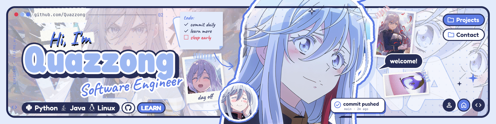
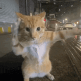
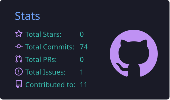

  

<h2 align="center">Hi there, I'm Hafiz Adli! 👋</h2>

  

<table>
  <tr>
    <td>
      
    </td>
    <td width=70% valign="middle">
      <h3>✨ About Me</h3>
      <ul>
        <li>🎓 I'm an Informatics Engineering Student</li>
        <li>🌱 Interested in doing something</li>
      </ul>
      

        
        
      

    </td>
  </tr>
</table>

<h2 align="center">Skills 💻️</h2>

<table width="100%">
  <tr>
    <td width="50%" align="center" valign="top">
      

      

    </td>
    <td width="50%" align="center" valign="top">
      

      

    </td>
  </tr>
</table>

<h2 align="center">GitHub Stats 📊</h2>

  
  

  <picture>
    <source media="(prefers-color-scheme: dark)" srcset="https://raw.githubusercontent.com/Quazzong/Quazzong/output/pacman-contribution-graph-dark.svg">
    <source media="(prefers-color-scheme: light)" srcset="https://raw.githubusercontent.com/Quazzong/Quazzong/output/pacman-contribution-graph.svg">
    
  </picture>

